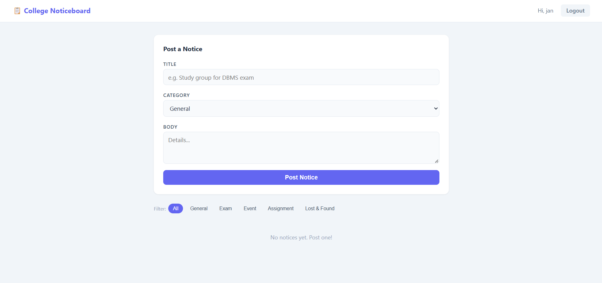

# College Noticeboard

A noticeboard where students post announcements and upvote them, without page reloads. Built with Flask, a JSON REST API, and vanilla JavaScript `fetch`.



**Live demo:** https://college-noticeboard-u7yj.onrender.com

> Hosted on Render's free tier. The first load can take about 50 seconds to wake up, and data resets on restart.

## Features

- Register and login with hashed passwords
- Post notices with a title, body, and category
- Upvote and un-upvote notices (one vote per user)
- Filter by category: General, Exam, Event, Assignment, Lost & Found
- Delete your own notices (other users' notices are protected)
- All actions update the page instantly via the Fetch API

## Tech Stack

- **Frontend:** HTML, CSS, vanilla JavaScript (Fetch API, async/await, DOM updates)
- **Backend:** Python, Flask, Flask-Login, Flask-SQLAlchemy
- **Database:** SQLite
- **Deployment:** Render, Gunicorn

## REST API

| Method | Endpoint | Description |
|---|---|---|
| GET | `/api/posts?category=Exam` | List notices, optionally filtered |
| POST | `/api/posts` | Create a notice (JSON body) |
| DELETE | `/api/posts/<id>` | Delete your own notice |
| POST | `/api/posts/<id>/upvote` | Toggle upvote |

All API routes require login. Responses are JSON with proper status codes (201, 400, 403, 404).

## Database

Three tables: `User`, `Post`, `Upvote`.

- A user has many posts.
- A post has many upvotes, and deleting a post cascades to its upvotes.
- `Upvote` links a user to a post.

## Run locally

```bash
git clone https://github.com/samish-bit/college-noticeboard.git
cd college-noticeboard
python -m venv venv
venv\Scripts\activate      # Windows
source venv/bin/activate   # Mac/Linux
pip install -r requirements.txt
python app.py
```

Open `http://127.0.0.1:5000`

## What I learned

- Building a JSON REST API in Flask instead of form-based routes
- Calling an API from JavaScript with `fetch` and updating the DOM without reloads
- Modelling one-to-many relationships and cascade deletes
- Deploying Flask with Gunicorn on Render

## Author

Samish Pradhan: [GitHub](https://github.com/samish-bit)
